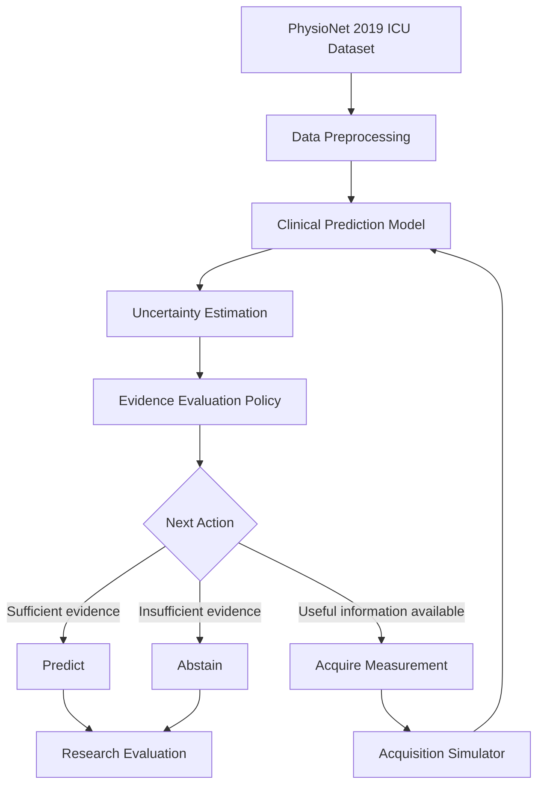

# Stage 1 — System Architecture

**Project:** Evidence-Aware Clinical AI

**Goal:** Evaluate available patient information and determine whether to predict, acquire additional information, or abstain.

## High-Level Architecture

## Planned Components

### Data Processing
Load and preprocess hourly ICU patient observations.

### Clinical Prediction
Train Logistic Regression and XGBoost baselines.

### Uncertainty Estimation
Evaluate calibration and predictive uncertainty.

### Evidence Evaluation
Determine whether additional information may improve prediction reliability.

### Acquisition Simulator
Simulate measurement acquisition using historical observations.

### Decision Regulation
Choose between predicting, acquiring information, or abstaining.

### Evaluation
Compare prediction quality, acquisition cost, and decision reliability.

## Research Status

Architecture proposed. Implementation and experimental validation pending.