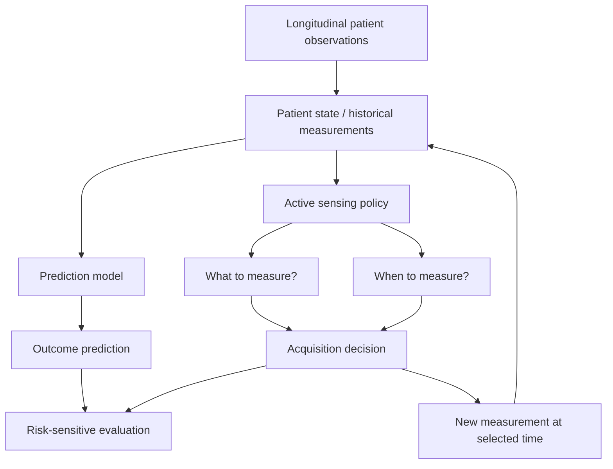

# P002 — Risk-Averse Active Sensing (NeurIPS 2023)

**Title:** Risk-Averse Active Sensing for Timely Outcome Prediction under Cost Pressure

**Venue:** NeurIPS 2023  
**Review status:** Initial literature review

**Paper:** [https://proceedings.neurips.cc/paper_files/paper/2023/hash/1498a03a04f9bcd3a7d44058fc5dc639-Abstract-Conference.html](https://proceedings.neurips.cc/paper_files/paper/2023/hash/1498a03a04f9bcd3a7d44058fc5dc639-Abstract-Conference.html)

**Code:** [https://github.com/yvchao/cvar_sensing](https://github.com/yvchao/cvar_sensing)

## Research Problem

Clinical monitoring involves deciding not only which measurements to collect but also when to collect them.

Frequent measurements may improve prediction but increase cost and resource use. Delaying measurements may reduce costs but risk missing important clinical changes.

## Proposed Approach

The paper investigates risk-sensitive active sensing for longitudinal outcome prediction.

The sensing policy considers:

- which measurements should be acquired;
- when measurements should be acquired;
- the tradeoff between timely prediction and sensing cost;
- the risk associated with unfavorable prediction outcomes.

## Architecture

## Relevance to Our Project

This paper is an important methodological reference for temporal acquisition.

It demonstrates that time-aware and cost-aware sensing have already been investigated.

Our project must therefore identify a more specific contribution than simply adding measurement timing or cost.

## Planned Use

We will study its formulation and official implementation to determine whether it can serve as an additional baseline.

A faithful implementation may require more work than our initial Logistic Regression, XGBoost, and simple acquisition policies.

We will prioritize this comparator only if it is compatible with our experimental protocol and available development time.

## Published Results

Numerical results have not yet been extracted and independently verified for this review.

Before adding published metrics, record the exact dataset, task, acquisition budget, evaluation metric, and table or figure number.

## Potential Research Difference

Our proposed experiments investigate evidence sufficiency and the decision to predict, acquire, or abstain under explicitly defined measurement availability and simulated delay constraints.

This difference remains a research hypothesis rather than an established novelty claim.

## Open Questions

- Can the published sensing policy be adapted to PhysioNet Challenge 2019?
- How does it behave when candidate measurements are unavailable?
- How should acquisition delay be modeled separately from the time chosen for the next measurement?
- Can abstention improve decision reliability when acquisition is not useful or feasible?

## Conclusion

This paper is a strong temporal active-sensing reference and potential advanced comparator. It should be considered when designing our acquisition experiments, but direct numerical comparison requires a shared dataset and evaluation protocol.